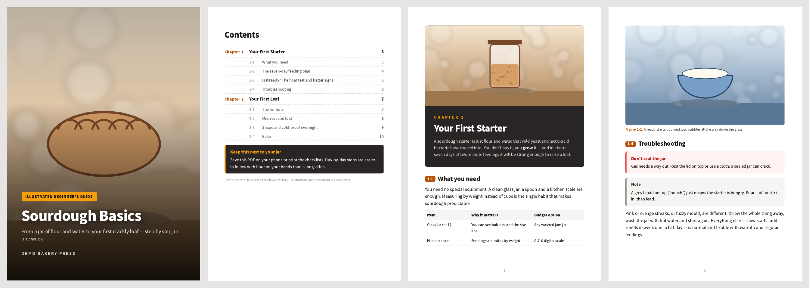
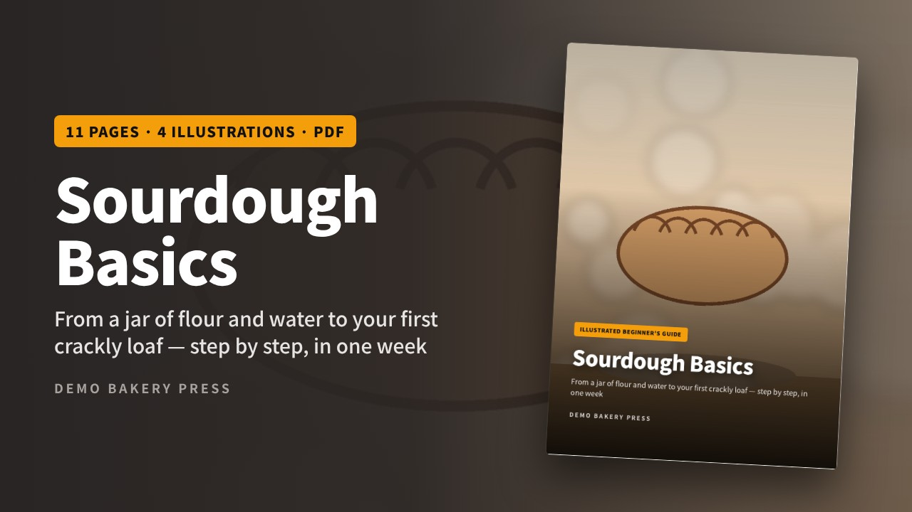
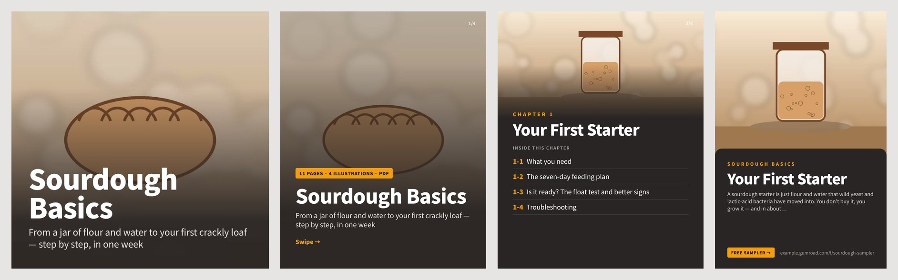

# ebook-factory

> **Pro license:** [ebook-factory Pro on Gumroad](https://minkster072.gumroad.com/l/hkzyzu)

**Write chapters in Markdown. Get a print-quality illustrated PDF ebook — plus the free sampler, store cover and social images you need to sell it.**



## The problem

Selling a PDF guide on Gumroad, Etsy or Latpeed takes more than the PDF. You need:

- a book that **looks designed**: cover, chapter openers, callout boxes, figures, printable checklists
- a **table of contents with real page numbers** and clickable bookmarks
- a **phone-friendly edition**, because most buyers open the file on a phone and a 40 MB PDF is a bad first impression
- a **free sampler** to grow an email list, ending in a page that links to the paid product
- a **store cover (1280×720)**, a **square thumbnail**, an **Instagram carousel** and **Pinterest pins**

Word and Google Docs can't do the page numbers or the layout. Canva can't take 200 pages of text. InDesign takes a week to learn. Most creators spend days on the parts that aren't the writing.

ebook-factory does all of it from one folder in under ten seconds.

## 60-second quickstart

```bash
pip install -r requirements.txt          # or: pip install -e .
python -m playwright install chromium    # one-time, ~150 MB

ebookfactory init my-book                # book.yaml, chapters/01-intro.md, images/
cd my-book
ebookfactory build                       # dist/my-book.pdf + dist/my-book-phone.pdf
ebookfactory sampler --chapters 1        # dist/my-book-sampler.pdf   (Pro)
ebookfactory assets                      # dist/assets/*.jpg           (Pro)
```

Try the demo book instead:

```bash
ebookfactory all --book examples/sourdough-basics
```

## Write like this

```markdown
---
image: images/starter-hero.jpg      # optional chapter-opener art
---
# Your First Starter

The first paragraph becomes the lead text in the chapter header.

## What you need                     <- numbered section 1-1, listed in the TOC with its page


> [!TIP] Start on a weekend          <- also NOTE, DO, DONT, WARNING, IMPORTANT
> Day 1 takes ten minutes.

- [ ] Doubles within 4–8 hours      <- a real printable checkbox
- [x] Smells like yogurt

| Day | What to do |                  <- tables, with headers repeated on page breaks
|---|---|
| 1 | Mix and cover |
```

## book.yaml

```yaml
title: "Sourdough Basics"
subtitle: "From a jar of flour and water to your first crackly loaf"
author: "Demo Bakery Press"
language: en          # en, ko, ja... sets fonts, line breaking and built-in labels ("Chapter 1" / "1장")
page_size: A5         # A5 (default), Letter, 6x9
theme: classic        # classic (free) | midnight, sage, rose (Pro)
colors: { accent: "#b45309", dark: "#292524", highlight: "#f59e0b" }
cover_image: images/cover.jpg
cover_tag: "Illustrated beginner's guide"
price: "$7"
buy_url: "https://example.gumroad.com/l/sourdough-basics"     # sampler CTA + carousel
free_url: "https://example.gumroad.com/l/sourdough-sampler"   # Pinterest pins point here
intro_box:                                                    # optional box under the contents
  title: "Keep this next to your jar"
  text: "Save this PDF on your phone or print the checklists."
sampler: { chapters: [1] }
```

## What you get

| Output | Size | Notes |
|---|---|---|
| `dist/<book>.pdf` | A5 / Letter / 6×9 | Print images (up to 2600 px), PDF bookmarks, page numbers, metadata |
| `dist/<book>-phone.pdf` | about half the size | Same pages, images downscaled to 1000 px |
| `dist/<book>-sampler.pdf` | | Chosen chapters + a "Get the full book" page with price, button, link and QR code |
| `dist/assets/cover-1280x720.jpg` | 1280×720 | Gumroad / Etsy cover with a mock-up of your real cover page and page count |
| `dist/assets/thumb-600x600.jpg` | 600×600 | Store thumbnail |
| `dist/assets/carousel-NN.jpg` | 1080×1350 | Instagram 4:5 carousel: hook, one slide per chapter (its sections), CTA |
| `dist/assets/pin-NN.jpg` | 1000×1500 | One Pinterest pin per chapter, pointing to your free sampler |





The free sampler ends with a call-to-action page:


## Features

- **Markdown in, designed book out.** Numbered sections, chapter openers with art, numbered figures with captions, six callout styles, tables, printable checklists, code blocks.
- **A table of contents with real page numbers.** Two-pass render: pass 1 drops invisible markers, `pdftotext` finds the page each chapter and section landed on, pass 2 prints the numbers. The layout doesn't move between passes, so the numbers stay right.
- **Clickable everywhere.** TOC rows link to their pages, and the PDF has a bookmark outline.
- **Print and phone editions** from one source.
- **English and Korean** (and CJK in general) through Noto Sans / Noto Sans CJK, with Korean word-keeping line breaks and Korean labels.
- **Your brand colours** in `book.yaml`. No CSS needed.
- **Fast.** The 11-page demo builds both editions in about 3 seconds on one reused headless Chromium.

## Free vs Pro

| | Free (MIT) | Pro |
|---|:---:|:---:|
| `init`: scaffold a book | ✓ | ✓ |
| `build`: print PDF + phone PDF | ✓ | ✓ |
| Auto TOC with page numbers, bookmarks, page footer | ✓ | ✓ |
| Callouts, figures, tables, checklists, EN/KO fonts | ✓ | ✓ |
| Custom colours, A5 / Letter / 6×9 | ✓ | ✓ |
| `sampler`: lead-magnet PDF + CTA page + QR | preview (watermarked) | ✓ |
| `assets`: store cover, thumbnail, carousel, pins | preview (watermarked) | ✓ |
| Premium themes `midnight`, `sage` (serif), `rose` (serif) | — | ✓ |

Pro unlocks with a license key. **[Get ebook-factory Pro on Gumroad](https://minkster072.gumroad.com/l/hkzyzu)** — one-time payment, the key arrives in your receipt.

```bash
ebookfactory activate YOUR-GUMROAD-LICENSE-KEY      # checks once online, then works offline for 30 days
# or, for CI/Docker:  export EBOOKFACTORY_KEY=YOUR-GUMROAD-LICENSE-KEY
```

Without a key, Pro commands still run in full and stamp a small "ebook-factory Pro preview" mark, so you can try everything before you buy.

## Requirements

- Python 3.10+
- Chromium for Playwright: `python -m playwright install chromium`
- `pdftotext` / `pdftoppm` from poppler-utils (recommended; the tool falls back to pypdf to read page numbers)
- Fonts: Noto Sans CJK (`fonts-noto-cjk` on Debian/Ubuntu) for Korean, Japanese and Chinese

## Development

```bash
pip install -e ".[dev]"
pytest -q                              # builds the demo end to end, checks page count, TOC numbers, assets, Korean
python scripts/make_demo_images.py     # regenerate the placeholder illustrations
python scripts/render_docs.py          # regenerate the screenshots in docs/
```

## License

Core (everything outside `ebookfactory/pro/`): **MIT**, see [LICENSE](LICENSE).
`ebookfactory/pro/`: source-available, see [LICENSE-PRO](LICENSE-PRO).
